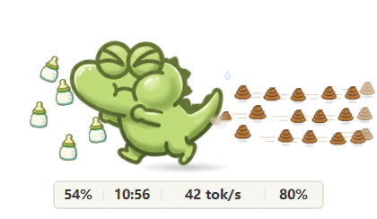

# Croc Token HUD

让 Codex 的工作状态，变成桌面上的一个小伙伴。

一个 Windows 透明悬浮角色：休息时放松，工作时用动画表现输出速度。奶瓶显示剩余额度，右侧便便的行数、密度和移动速度随吞吐变化。支持导入自己的八动作角色包，也可以随时切回已有形象。



**[下载最新预览版](https://github.com/Hziibepacient/croc-token-hud/releases/tag/croc-v1.4.0-beta.1) · [全部版本](https://github.com/Hziibepacient/croc-token-hud/releases) · [详细使用说明](CROC_README.md)**

> 当前提供的是 Windows **源码预览包**，需要 Python 3.10+ 和 Windows .NET Framework 4.x。首次运行自动编译窗口；没有内置 Python，不是免安装运行包。新版发布为预览版时，请在“全部版本”页面下载。

## 它能做什么

- **桌面悬浮**：透明、置顶、无边框；拖动移动，滚轮缩放，托盘恢复隐藏窗口。
- **看输出速度**：五档动画、连续变速，便便先从身体后方出发，再向上下分道。
- **看额度和缓存**：紧凑底栏显示所选周期剩余额度、重置时间、平均输出速度及最近响应缓存命中率。
- **选择观察范围**：跟随最新活动、跟随当前 Codex 对话，或者固定一个聊天。
- **更换角色**：右键选择已有形象；通过本地工作台上传 ZIP、预览八个动作、确认后添加。
- **自己做角色**：复制完整指令，把一张或多张参考图交给具备生图能力的 Codex，生成可导入的角色包。

## 三步启动

1. 在 [Releases](https://github.com/Hziibepacient/croc-token-hud/releases) 下载 `CrocToken-preview-source.zip`，完整解压到一个文件夹；也可直接 [下载仓库源码](https://github.com/Hziibepacient/croc-token-hud/archive/refs/heads/main.zip)。
2. 确认已安装 Python 3.10+，并能在终端运行 `python --version`。使用新增角色和工作台图片预览前，在解压目录运行：

   ```powershell
   python -m pip install -r requirements-croc.txt
   ```

   该依赖用于本地图像处理。只使用原版鳄鱼时不需要安装它。
3. 双击 **`StartCrocDesktop.cmd`**。打开 Codex、开始一个任务，再右键角色选择要观察的对话。

首次启动会调用 Windows .NET Framework 编译器。请先完整解压，不要在 ZIP 里面直接双击脚本。手动启动后会一直显示在桌面；右键菜单可以隐藏或退出。

## 动画和底栏怎么看

| 画面 | 表达的意思 |
| --- | --- |
| 左侧奶瓶 | 所选额度周期的剩余百分比，每瓶约 20%，最后一瓶显示零头 |
| 角色姿势 | 休息、工作、思考、喝奶、松口气等状态 |
| 右侧便便 | 最近完成响应的平均输出吞吐；速度越快，移动越快、数量越密 |
| 下方四个值 | 剩余额度百分比 / 重置时间 / 输出 `tok/s` / 缓存命中率 |

五档边界为 **15、30、60、100 tok/s**，对应 **1 / 1 / 2 / 2 / 3 行**。行数和运动表达速度，不表达历史累计 Token 数。切换工作状态、角色或试播速度，不会把剩余奶瓶自动补满。

重置时间使用本机时间；当天显示时分，跨日显示月日，完整时间可在右键菜单查看。没有可用额度或计数时显示未知或等待更新，不会补成 100%。

## 右键菜单

- **选择观察的对话**：最新活动跟随最近写入本地日志的聊天；当前对话识别 Codex 窗口中正在查看的聊天；也可固定一个聊天。
- **额度周期**：自动选择，或选择本地实际记录过的周期，例如五小时、每周。没有记录的周期不会凭空推算。
- **更换形象**：直接切换已添加的角色；点“添加新形象…”打开本地角色工作台。
- **其他操作**：查看模型、缓存和计数来源，调整大小，试播动画，置顶、隐藏或退出。

当前对话识别依赖 Windows 本地窗口信息。标题重复、窗口无法识别或匹配不唯一时会等待，不会偷偷切成其他聊天；可以改用最新活动或固定聊天。

## 做一个自己的角色

在本地工作台上方，按这三步操作：

1. **准备参考图**：一张或多张照片、插画均可。多张图请告诉 Codex 主参考是哪张，其他图参考什么。
2. **在 Codex 中生成**：复制工作台里的完整指令，连同参考图一起发送。也可以把制作工具包附给 Codex，里面包含格式说明、校验脚本和可选 skill。无需自己写代码或安装 skill。
3. **回来导入 ZIP**：下载 Codex 生成的 ZIP，直接上传到工作台，无需解压。检查动作、脚底和喷射位置，点击“添加并使用”。

八个动作是：**休息、下蹲、工作、后坐、松口气、思考、喝奶、起跳**。保留参考角色的画风，像素角色使用最近邻采样。新角色沿用奶瓶、便便和数据栏，使用通用呼吸、弹跳和后坐力；原鳄鱼继续保留专属精细动画。

- [完整 Codex 生成指令](docs/Codex角色包生成指令.md)
- [角色包格式、坐标及校验要求](docs/character-pack-v1.md)
- [项目内可选 skill](skills/croc-character-pack/SKILL.md)

角色包使用八张 **1024×1024 透明 PNG**、`character.json` 和总览图。JPG 不支持所需透明背景，不接受直接导入。只生成一张展示图不等于完成角色包；请让 Codex 继续完成八个动作和打包。

## 性能与本地数据

1024 像素图片是制作原图，桌面导入时会转换为 **416×416** 的运行素材，只加载当前角色；工作台使用 416 像素动作预览及 96 像素缩略图，预览最多 30 帧每秒，页面隐藏时暂停绘制。八帧 416 像素 RGBA 数据约 5.28 MiB，这不是整个进程或显存的占用值。

Token、速度、缓存及额度快照读取本机 Codex 日志；工作台只监听 `127.0.0.1`，需要本次启动的访问令牌。角色、选择和布局默认保存在 `%USERPROFILE%\.codex-token-hud\croc-desktop`，也支持 `CODEX_TOKEN_HUD_HOME`。应用不会上传聊天或角色；使用 Codex 生图是用户在 Codex 内单独进行的操作。

## 数据边界

- **速度不是逐 Token 的瞬时测速**：计数通常在一次模型响应完成后写入，本工具使用最近完成响应的平均输出速度。任务可能直到结束后才有新数据。
- **额度是最后一条本地快照**：不是实时联网余额；过重置时间但未收到新记录时会等待更新，不自动回满。
- **额度属于账号窗口**：不能据此推算某个聊天单独花掉了多少套餐额度。缓存命中率也不直接等于省下的金额。
- **中转站余额尚未接入**：本版没有中转站余额或到期时间查询，不根据 Token 数或模型价格伪造美元余额。
- **桌面角色功能面向 Windows**：保留的浏览器场景、原项目状态栏和 macOS/Linux 工具不等于已经支持本版角色工作台的完整桌面体验。

## 本地开发与打包

以下命令面向完整 Git 仓库。Release 源码预览包用于直接运行；进行完整开发和测试时请克隆仓库。

```powershell
python -m pip install -r requirements-croc.txt
python -m unittest discover -s tests -p "test_*.py"
python BuildCharacterGuide.py --check
python PackageCroc.py
```

源码预览包输出到 `dist/CrocToken-preview-source.zip`，同时生成 SHA256 校验文件。生成指令、角色规范和 skill 来自同一份构建脚本；修改规范后运行 `python BuildCharacterGuide.py` 同步。

本项目的 Croc 发布流程会运行 Python 测试、编译桌面窗口、执行原生自检，再从明确的公开文件清单打包，并在 Releases 提供源码包与制作工具包。真实日志、访问令牌、机器配置及原始角色参考图不进入发布包。

## 署名与许可

交互设计与维护：**[Hziibepacient](https://github.com/Hziibepacient)**。桌面动效等协作贡献参见 [Sid-Qin](https://github.com/Sid-Qin) 与仓库贡献记录。

基于 **[drkang7/codex-token-hud](https://github.com/drkang7/codex-token-hud)** 开发，保留原作者及贡献者的版权声明与 [MIT 许可证](LICENSE)。原项目提供日志读取、统计及基础工具；本项目增加桌面角色表达、角色包规范与本地角色工作台。角色素材由参考图及 AI 辅助生成、整理，外部素材的授权不因代码采用 MIT 而自动改变。

这是独立社区项目，与 OpenAI 无隶属关系。欢迎通过 [Issues](https://github.com/Hziibepacient/croc-token-hud/issues) 反馈问题，通过 Pull Request 一起改进。反馈时请说明 Windows/Python 版本、角色及缩放、跟随模式和复现步骤，截图中避免包含聊天内容或访问令牌。
